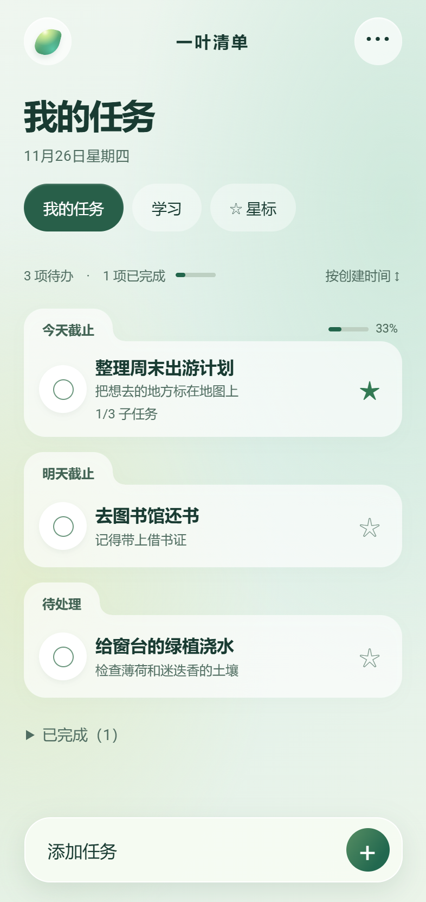

# 一叶清单

一款中文离线 Android 待办应用。可以把任务分到不同清单，设置截止日期、添加备注和星标，也可以将任务拆成可勾选的子任务。数据保存在设备上。

[下载 Android 安装包（v1.1）](https://github.com/zihma/LeafTasks/releases/tag/v1.1) · 支持 Android 8.0 及以上版本。

## 本地开发

用 Android Studio 打开项目根目录，安装 Android SDK Platform 35 后运行应用。安卓入口位于 `src/main/java`，离线界面位于 `src/main/assets`。
